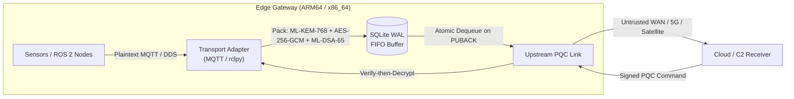
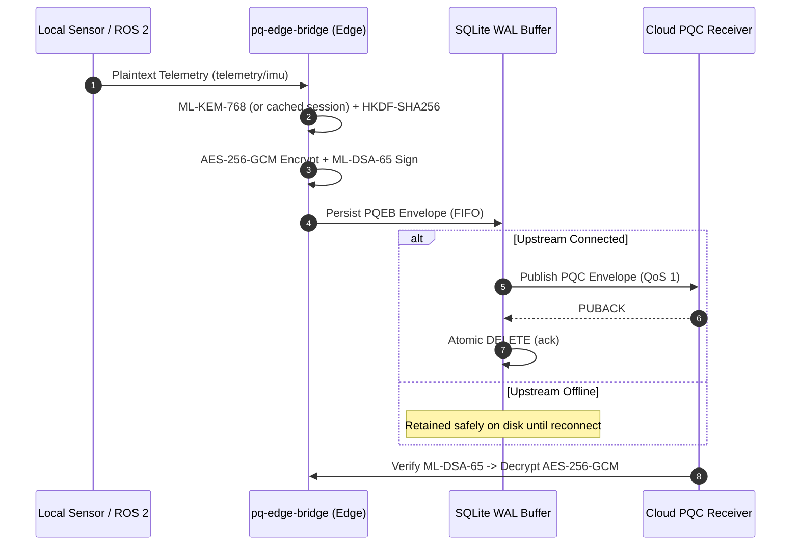

<div align="center">

# 🔐 `pq-edge-bridge`

### Post-Quantum Telemetry Bridge for Edge, IoT & Robotics

[](LICENSE)
[](pyproject.toml)
[](.github/workflows/ci.yml)
[](docs/PROTOCOL_SPEC.md)
[](deploy/docker/Dockerfile)

**Defeat *"Harvest Now, Decrypt Later"* attacks on constrained edge, industrial IoT, and autonomous robotics telemetry — without rewriting your sensors or ROS 2 nodes.**

[Architecture](docs/ARCHITECTURE.md) • [Protocol Spec](docs/PROTOCOL_SPEC.md) • [Operator Manual](docs/OPERATOR_MANUAL.md) • [Benchmarks](docs/BENCHMARKS.md)

</div>

---

## 🛡️ Why `pq-edge-bridge`?

Adversaries are already intercepting and archiving encrypted cellular, satellite, and WAN telemetry today to decrypt it once fault-tolerant quantum computers arrive (**Harvest Now, Decrypt Later**). Meanwhile, legacy edge buses (**MQTT**, **ROS 2 / DDS**) lack native post-quantum protection and frequently suffer from intermittent WAN connectivity.

`pq-edge-bridge` acts as a **drop-in, zero-trust cryptographic sidecar** on your edge gateway:

- 🔑 **NIST-Standardized Post-Quantum Cryptography:** Hybrid **ML-KEM-768** (FIPS 203) key encapsulation + **HKDF-SHA256** + **AES-256-GCM** authenticated encryption + **ML-DSA-65** (FIPS 204) digital signatures via compiled `liboqs`.
- ⚡ **Edge-Optimized Session Rotation:** Amortizes ML-KEM-768 overhead across configurable message-count or time-based rotation windows (**~0.15 ms p50** pack latency, **~37 MiB RSS**).
- 💾 **Zero-Loss Offline Store-and-Forward:** Crash-safe **SQLite WAL-mode** FIFO buffer with atomic dequeue-on-ack (`PUBACK`) and configurable disk quotas.
- 🤖 **MQTT & ROS 2 / DDS Native:** Bridges local plaintext MQTT topics or ROS 2 `UInt8MultiArray` topics to upstream PQC-protected channels — and unwraps signed inbound C2 commands back to the local bus.
- 📈 **Zero-Dependency Observability:** Opt-in localhost `/healthz` (JSON) and Prometheus `/metrics` endpoint for Grafana dashboards and Docker/Kubernetes healthchecks.
- 🔒 **Hardened by Default:** Atomic `chmod 600` key generation, `Verify-then-Decrypt` framing, sliding-window replay protection, least-privilege `systemd` unit, and multi-arch (`amd64`/`arm64`) Docker image.

---

## 🏗️ Architecture



### Session & Envelope Sequence



---

## ⚡ Quickstart

### 1. Install `liboqs` & `pq-edge-bridge`

```bash
git clone https://github.com/PelleNybe/pq-edge-bridge.git
cd pq-edge-bridge
./deploy/scripts/install_liboqs.sh
pip install .
```

### 2. Generate Post-Quantum Keypairs (`chmod 600`)

```bash
pq-edge-bridge keygen --output-dir ./keys --prefix edge-01
pq-edge-bridge keygen --output-dir ./keys --prefix cloud
```

### 3. Encrypt, Verify, Inspect & Decrypt via CLI

```bash
# Encrypt & sign telemetry
pq-edge-bridge encrypt \
  --peer-kem-pub ./keys/cloud.kem.pub \
  --sig-key ./keys/edge-01.sig.key \
  --sender-id edge-01 \
  --topic telemetry/imu \
  --message '{"ax":0.01,"ay":-0.02,"az":9.81}' \
  --out ./telemetry.pqeb

# Verify ML-DSA-65 signature without decrypting
pq-edge-bridge verify --peer-sig-pub ./keys/edge-01.sig.pub --in ./telemetry.pqeb

# Inspect wire metadata
pq-edge-bridge inspect --in ./telemetry.pqeb

# Verify & decrypt
pq-edge-bridge decrypt \
  --kem-key ./keys/cloud.kem.key \
  --peer-sig-pub ./keys/edge-01.sig.pub \
  --in ./telemetry.pqeb
```

### 4. Configure & Run the Bridge Daemon

```bash
# Generate a starter configuration
pq-edge-bridge init-config --out ./config.yaml --node-id edge-01 --keys-dir ./keys

# Start the async MQTT / ROS 2 PQC bridge
pq-edge-bridge run --config ./config.yaml

# Inspect offline SQLite WAL queue occupancy
pq-edge-bridge buffer-stats --db ./pq_edge_bridge.db

# On the cloud side, verify & decrypt incoming telemetry
python examples/cloud_receiver.py \
  --broker 127.0.0.1 --port 1883 \
  --kem-key ./keys/cloud.kem.key \
  --peer-sig-pub ./keys/edge-01.sig.pub
```

---

## 📊 Performance & Feature Matrix

Measured on Linux `x86_64` with `liboqs 0.16.0` ([full benchmark report](docs/BENCHMARKS.md)):

| Metric | Full Per-Message KEM | Session-Reuse (1,000 msgs) |
| :--- | :--- | :--- |
| **Pack Latency (p50 / p99, 1 KiB)** | `0.187 ms` / `0.429 ms` | `0.152 ms` / `0.491 ms` |
| **Unpack Latency (p50 / p99, 1 KiB)** | `0.131 ms` / `0.143 ms` | `0.096 ms` / `0.105 ms` |
| **Wire Overhead** | `+4,500 B` | `+3,417 B` (-24%) |
| **Process Memory (RSS)** | `~36.9 MiB` | `~36.9 MiB` |
| **Forward Secrecy Granularity** | Every message | Every `N` messages or `T` seconds |

---

## 🧩 Technical Details

<details>
<summary><strong>📦 Binary Wire Format (<code>PQEB</code> v1)</strong></summary>

```text
+--------+---------+-------+---------------+-----------+-----------+-----------+
| Magic  | Version | Flags | SenderID Len  | SenderID  | Topic Len | Topic     |
| 4 B    | 1 B     | 1 B   | 1 B (1..64)   | N B       | 2 B       | M B       |
+--------+---------+-------+---------------+-----------+-----------+-----------+
| Timestamp (ns) | Sequence | Session ID | KEM CT Len | KEM Ciphertext (opt)  |
| 8 B (uint64)   | 8 B      | 16 B       | 2 B        | 0 or 1,088 B          |
+----------------+----------+------------+------------+-----------------------+
| Nonce (GCM) | Ciphertext Len | Ciphertext + 16 B GCM Tag | Sig Len | ML-DSA-65 Sig |
| 12 B        | 4 B (uint32)   | L B                       | 2 B     | 3,309 B       |
+-------------+----------------+---------------------------+---------+---------------+
```

- **AAD:** `Magic` through `Nonce` inclusive.
- **ML-DSA-65 Signature:** Covers `Magic` through `Ciphertext + GCM Tag` inclusive (`Verify-then-Decrypt`).

</details>

<details>
<summary><strong>🐧 Hardened <code>systemd</code> Service Setup</strong></summary>

```bash
sudo useradd --system --home-dir /var/lib/pq-edge-bridge --create-home pqbridge
sudo cp deploy/systemd/pq-edge-bridge.service /etc/systemd/system/
sudo systemctl daemon-reload
sudo systemctl enable --now pq-edge-bridge
```

Includes `NoNewPrivileges=yes`, `ProtectSystem=strict`, `ProtectHome=yes`, `PrivateDevices=yes`, `CapabilityBoundingSet=`, and `UMask=0077`.

</details>

<details>
<summary><strong>📈 Prometheus <code>/metrics</code> &amp; <code>/healthz</code> Observability</strong></summary>

Enable the opt-in localhost HTTP endpoint in `config.yaml` (disabled by default):

```yaml
observability:
  enabled: true
  host: "127.0.0.1"
  port: 9108
```

- `GET /healthz` — JSON status (`status`, `upstream_connected`, `buffer_messages`, `buffer_bytes`, `session_rotations`)
- `GET /metrics` — Prometheus `0.0.4` counters & gauges (`pq_bridge_telemetry_received_total`, `pq_bridge_telemetry_forwarded_total`, `pq_bridge_commands_received_total`, `pq_bridge_commands_rejected_total`, `pq_bridge_buffer_messages`, `pq_bridge_session_rotations_total`)

</details>

<details>
<summary><strong>🤖 ROS 2 / DDS Configuration</strong></summary>

Install inside a sourced ROS 2 environment (`pip install ".[ros2]"`), then enable `ros2:` in `config.yaml`:

```yaml
ros2:
  enabled: true
  node_name: "pq_edge_bridge_node"
  inbound_topics:
    - "/telemetry/raw"
  outbound_command_topics:
    - "/cmd/raw"
  upstream_topic_prefix: "pqc/ros2"
  qos_depth: 10
```

</details>

---

## 🤝 Creators & Credits

| Role | Attribution |
| :--- | :--- |
| **Organization** | [**Corax CoLAB**](https://coraxcolab.com) — *Deep Tech, Edge AI & Robotics Innovation* |
| **Lead Developer** | **Pelle Nyberg** ([GitHub: `@PelleNybe`](https://github.com/PelleNybe)) |

---

## 📄 License

Licensed under the [Apache License, Version 2.0](LICENSE).
